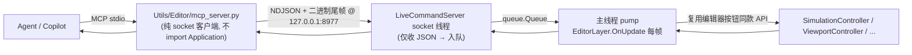

# 编辑器实时命令总线 / MCP 热注入协议（Editor Live）

> 适用：`Application/Editor/Services/LiveCommandServer.py`（编辑器侧总线）、
> `Utils/Editor/**`（agent 侧 MCP 服务器与安装）、`Application/Editor/EditorLayer.py`（pump 接入点）、
> `Application/Editor/EditorPlugin.py`（启停接入点）。
> 目标：让 agent 像操作 Fusion360 一样**实时操作运行中的编辑器**（热注入，非文件式）。

---

## 1. 架构与线程纪律



**硬约束（free-threading 无 GIL）**：
- socket 线程只做 JSON 编解码 + 入队 + 等待回执；
- **一切编辑器状态变更只在主线程 `pump()` 执行** —— 与人类点击走完全相同代码路径；
- 每帧限量（16 条）保证帧率；单条命令回执等待上限 15s。

## 2. 端点与配置

| 项 | 值 |
|---|---|
| 地址 | `127.0.0.1:<port>`（**仅回环**，外部网络不可达） |
| 端口 | 默认 `8977`；环境变量 `MGE_EDITOR_MCP_PORT` 覆盖（编辑器与 MCP 两侧都读） |
| 启动 | 编辑器加载时由 `EditorPlugin.on_load → LiveCommandServer.start()` 自动启动 |
| 停止 | `EditorPlugin.on_unload → stop()`；daemon 线程随进程退出 |
| 端口占用 | 打印 `[Live] WARNING: cannot bind ...` 并禁用（不阻塞编辑器） |
| 审计日志 | 每条命令在主线程打印 `[Live] id=<n> op=<op> → ok / ERR ...` |

## 3. 协议（NDJSON + 二进制尾帧）

一行一条 JSON；请求-响应一一对应：

```json
请求:  {"id": 1, "op": "sim.play", "args": {}}
回执:  {"id": 1, "ok": true,  "result": {"requested": true, "state": "pending_start"}}
错误:  {"id": 1, "ok": false, "error": "ValueError: unknown op: 'foo' (available: ...)"}
```

- `id`：任意值原样回传（int/str）；
- 非法 JSON → `{"id": null, "ok": false, "error": "invalid request: ..."}`；
- 主线程超时未消费 → `{"ok": false, "error": "timeout waiting for editor main thread"}`；
- **二进制尾随帧（v2 — 图像通道）**：若回执行 `result.binary_bytes = N`，则该行之后紧跟 N 字节
  裸负载（RGBA8, bottom-up）——客户端必须先读行、再精确读 N 字节；其余响应仍为严格单行 NDJSON。

## 4. op 表（v2 基础 13 条 — 2026-09-28 实机验证；v3 容器表见 §4.1）

| op | MCP 工具 | args | 语义（等价的人工操作） | 响应 |
|---|---|---|---|---|
| `sim.play` | `editor_run_pie` | — | 点 **Run**（帧末消费） | `{requested, state}` |
| `sim.stop` | `editor_stop_pie` | — | 点 **Stop**（帧末消费） | `{requested, state}` |
| `sim.state` | `editor_sim_state` | — | 只读（状态机 + PIE 线程存活） | `{state, runtime_alive}` |
| `view.set_mode` | `editor_switch_2d` / `editor_set_scene_type` | `{"mode": "2d"\|"3d"\|"overlay"}` | **Scene Type 按钮完整语义**：`set_game_type`（决定 PIE 用哪台摄像机）+ 视口切换 | `{mode, label, game_type}` |
| `camera.get` | `editor_camera_get` | `{"role": "3d"\|"2d"\|"overlay"}` | 读场景摄像机实体（Transform + Camera） | `{position, rotation, projection, ...}` |
| `camera.set` | `editor_camera_set` | role + 部分字段（position/rotation/projection/ortho_size/fov/...） | Inspector 改摄像机属性（仅编辑器场景） | 更新后快照 |
| `graph.list` | `editor_graph_list` | — | 节点图快照（复用 canvas API, 不经 UI） | `{nodes, links}` |
| `graph.add` | `editor_graph_add` | `{"type", "props"?, "position"?}` | Add 菜单加节点 | `{node_id, type, props}` |
| `graph.link` | `editor_graph_link` | `{"from": {node,pin}, "to": {node,pin}}` | 画布拖线 | `{link_id}` |
| `graph.set_props` | `editor_graph_set_props` | `{"node", "props"}` | 内联控件改属性 | `{node_id, props}` |
| `frame.request` | （`editor_capture` 内部） | `{"target": "editor"\|"pie"}` | 请求抓“下一渲染帧”（立即返回） | `{target, generation}` |
| `frame.fetch` | （`editor_capture` 内部） | `{"target", "generation"}` | 取帧; 就绪时行后跟二进制尾随帧 | `{ready, state, width, height, ..., binary_bytes}` |
| `editor.quit` | `editor_quit` | — | 点窗口 **X**（GLFW 正常关闭; 无窗口回退 `run_state=False`） | `{closing, via}` |

设计约定：
- **一切 op 复用编辑器现有 API**（不绕过控制器直接改状态），保证与人工操作行为一致；
- `view.set_mode` 会**写 `scene.game_type`**（与 Scene Type 按钮一致）——`2d` 时 PIE 启动选用 `DefaultCamera2D`（俯视正交）；
- 抓帧管线（`frame.*`）：主线程 pump 登记请求 → **目标引擎渲染线程**帧末 `glReadPixels`（SwapBuffer 前）
  → 单槽发布（generation 语义: ready / superseded / pending / error）→ 主线程 `fetch` 取回；
  主线程不等待、渲染线程不编码 —— PNG 编码在 MCP 进程（§5）；
- `graph.*` 直接操作 Node Editor 画布（PIE 注入的同一 canvas 实例）；
- v3 容器 ops（§4.1）与 v2 同一主线程泵机制；容器级缺口单独维护于 §10。

### 4.1 v3 — 实体 / 组件 / 选中 / 场景 / 资源（25 条, 2026-09-28 实机验证）

实体寻址: `{"id": N}` 或 `{"name": "..."}`（二选一; 名称不唯一时返回首个 + `duplicate_ids` 警告）。

| op | MCP 工具 | 语义（等价的人工操作） |
|---|---|---|
| `entity.list` | `editor_entity_list` | Entities 列表（`roots_only` 可仅根实体） |
| `entity.get` | `editor_entity_get` | 读取实体快照（组件/层级/可见性/transform — 角度制） |
| `entity.add` | `editor_entity_add` | 点 **+ New**（有选中时成为其子级; `parent` 可显式指定/解除） |
| `entity.rename` | `editor_entity_rename` | Inspector 名称框（不强制唯一; 返回重名警告） |
| `entity.delete` | `editor_entity_delete` | 点 **Delete**（含子实体; 删除选中者会清除选中） |
| `entity.transform` | `editor_entity_transform` | Inspector Transform（编辑器坐标/角度; `local` 本地; `relative` 相对调整=位移加法/旋转加法/缩放乘法; scale 可标量等比） |
| `entity.visible` | `editor_entity_visible` | 眼图标（editor）+ MeshRenderer.visible（render） |
| `entity.reparent` | `editor_entity_reparent` | 树拖拽建立父子（`"none"` 解除） |
| `selection.get/set/clear` | `editor_selection_*` | 点击选中 / 清空（`set` 默认带 gizmo — 等同视口点选） |
| `component.types` | `editor_component_types` | 组件注册表（当前: Camera / MeshRenderer / Transform） |
| `component.list` | `editor_component_list` | 实体组件名列表 |
| `component.add` | `editor_component_add` | Inspector Add Component（MeshRenderer 自动绑 Cube 网格） |
| `component.remove` | `editor_component_remove` | Inspector 移除组件（Transform 不可移除; MeshRenderer 同步注销 GPU） |
| `component.get` | `editor_component_get` | 组件字段快照（通用序列化; MeshRenderer 附带 mesh/material 语义摘要） |
| `component.set` | `editor_component_set` | 部分字段更新 — Transform 支持 relative/标量缩放; MeshRenderer 支持 color/mesh/material/material_name/shader/uniform/texture 系列; 其余字段直写 |
| `scene.list` | `editor_scene_list` | 场景列表 + 活跃场景 |
| `scene.switch` | `editor_scene_switch` | Scene 下拉切换（保存当前/加载/视口/节点图同步全流程） |
| `scene.create` | `editor_scene_create` | 点 **+** 新建场景 |
| `scene.save` | `editor_scene_save` | 点 **💾**（省略 path 用最近路径; 联动 startup_scene） |
| `scene.load` | `editor_scene_load` | 点 **📂** 加载 .scene |
| `resource.list` | `editor_resource_list` | 资源列表（mesh/shader/texture/material/prefab） |
| `resource.find` | `editor_resource_find` | 按名查找（线性扫描; 返回全部匹配） |
| `resource.material.get` | `editor_resource_material_get` | 材质详情（shader/颜色/纹理槽/uniform 键） |

## 5. MCP 侧（agent 工具）

- 文件：`Utils/Editor/mcp_server.py`（FastMCP，stdio）；**纯 socket 客户端，不 import Application**（测试守卫生效）；
- **v3 工具**：`entity_*` (8) / `selection_*` (3) / `component_*` (6) / `scene_*` (5) / `resource_*` (3) —— 容器级实时编辑（§4.1）；
- 编辑器未运行时返回人话错误：`编辑器未运行（127.0.0.1:8977 无监听）— 请先启动 startup.bat。`
- **帧图像**（`editor_capture`）：request → 轮询 fetch → numpy 翻转（GL bottom-up → top-down，本进程）→
  Pillow 编码 PNG → ① 落盘 ② 返回 MCP 图像内容块（agent 可直接查看画面 + 说明文本含路径）；
- 抓帧目录：`Utils/Editor/tmp/frames/frame_{editor|pie}_{时间戳}_g{gen}.png`；
  **清理策略（用户指定）：MCP server 每次启动清空**（仅 `python -m` 入口执行, import 不清空）；
- venv 依赖：`mcp` 1.10.1（FastMCP Image 内容块）+ `Pillow`（已装）；
- 注册：`.venv-py314t\Scripts\python.exe Utils/Editor/install_mcp.py` →
  写入工作区 `.vscode/mcp.json`（名称 `engine-editor-live`，command=venv python）→ **重载 VS Code 生效**；
  卸载：`... install_mcp.py --uninstall`。

## 6. 新增一个 op 的步骤（扩展清单）

1. `LiveCommandServer._register_ops()` 里注册 `"域.动作": cls._op_xxx`；
2. 实现 `_op_xxx(args) -> dict`（**主线程**执行；只调编辑器 API/控制器；错误直接 raise，pump 会转成受控错误）；
3. `Utils/Editor/mcp_server.py` 加一个 `@mcp.tool()` 薄包装（→ `_send("域.动作", args)`）；
   图像类 op: handler 返回的 result 里放 `_payload`（bytes）+ `binary_bytes`
   （socket 线程会在行后追加裸负载, 不入 JSON）；
4. 测试：`Test/Application/Editor/test_live_command_server.py` 加一条往返断言（图像类用 `roundtrip_binary`）；
5. 更新本文档 op 表（及 §5/§8/§9 如涉及）。

## 7. 故障排查

| 现象 | 原因 / 处理 |
|---|---|
| MCP 工具报"编辑器未运行" | 编辑器没开 / 端口被环境变量改了两侧不一致 / 启动日志里有 bind 失败 |
| 工具一直超时 | 编辑器主线程被卡住（如 modal 操作）；看编辑器控制台 `[Live] id=...` 是否有输出 |
| 端口占用 | 改 `MGE_EDITOR_MCP_PORT`（两侧同时设）或关掉占用进程 |
| `.vscode/mcp.json` 不生效 | 重载 VS Code 窗口；或 Command Palette → `MCP: List Servers` 手动重启 |
| 某个 server 的工具缺失 / 启动失败 | `.vscode/mcp.json` 的 `command`/`cwd` 指向已搬迁的旧仓库路径（2026-09 实测: node-graph-editor 曾指向 `...\MI-SSSEP\Experiment\MyGameEngine-Python`，该路径已不存在）→ 用 `Test-Path` 核对后更新为当前仓库路径，再重载 VS Code |
| `editor_capture` 超时 / 一直 pending | PIE 未运行（报 `PIE is not running`）/ 渲染线程卡住；看控制台 `[Live] frame.*` 审计行与 `sim.state` |

## 8. 测试与验收

```powershell
# 无头回环测试（46 项断言: 生命周期 / 控制 / 二进制尾随帧 / v3 容器受控错误; 不需要 GUI）
.venv-py314t\Scripts\python.exe Test/Application/Editor/test_live_command_server.py
# 实机 E2E-v2（需 startup.bat 运行中）: graph 搭建 → 2D → PIE → 双窗口抓帧 → 停机
.venv-py314t\Scripts\python.exe Test/Application/Editor/e2e_mcp_live_check.py
# 实机 E2E-v3: 实体新建/改名/移形 → 组件增改 → 选中 → 截图 → reparent → 删除
.venv-py314t\Scripts\python.exe Test/Application/Editor/e2e_mcp_entities_check.py
# 实机 E2E-v3.1: Transform/MeshRenderer “提示指示”: 标量缩放/相对位移/材质改名/uniform/纹理/显隐截图
.venv-py314t\Scripts\python.exe Test/Application/Editor/e2e_mcp_cue_check.py
```

实机验收基线（2026-09-28 已通过）：
1. `graph.add EntitySpawn(template=DefaultCube)` + `graph.link OnGameStart.exec → exec_in`
   → 控制台出现 `[EntitySpawn] 'DefaultCube' (eid=..., template='DefaultCube')`；
2. `view.set_mode 2d` → `game_type=2d`，PIE 使用 `DefaultCamera2D`（俯视正交）；
3. `capture pie` → **画面中央白色方块**（PNG 落盘 `Utils/Editor/tmp/frames/`）；
   `capture editor` → 编辑器全 UI 画面（含 ImGui）；
4. `camera.get` 返回实体 1 实时属性；`sim.stop` → `Stopped`；`editor.quit` → 正常退出；
5. v3 容器链路：`entity.add → rename → transform → component.add(MeshRenderer, 默认 Cube) →
   component.set(color 红, 材质自动独立为 `Default_copy`) → selection.set(gizmo) → 截图可见红色实体 →
   reparent → entity.delete` 全通；`resource.find` / `resource.material.get` / `scene.list` 正常；
6. v3.1 Transform/MeshRenderer（“提示指示”链路）：标量缩放（`scale: 2.0`）✓、相对位移（+[1,0,0] 后 x=1.0）✓、
   `material_name` / `shader`(按名) / `uniform`(uColor=[1,0.5,0] 数据验证) / `texture` 替换 ✓、
   `component.get` 附带 mesh/material 摘要 ✓；提示显隐两次截图（出现 120KB / 隐藏 95KB, 视觉确认消失）。

## 9. 路线（后续阶段）

- ~~阶段 2~~（2026-09-28 大部分落地）：`sim.stop` ✅、图编辑 ops（`graph.add/link/set_props` + `graph.list` ✅；
  `graph.remove` 未做）、`view.screenshot` ✅（`frame.request/fetch` + `editor_capture`，PNG 在 MCP 进程）；
  仍缺：`sim.pause/resume` 暴露、`graph.remove`、帧环形日志（"实时图像=调试日志"）；容器级缺口见 §10。
- **阶段 3**：事件推送（选中变化 → MCP 通知）、只读开关、多客户端、`validate_only` 空跑。

## 10. 容器补全跟进（Follow-ups — 2026-09-28 盘点）

MCP 容器接口（entity / component / scene / resource）的已知缺口与待补项；完成一项从本表划掉并在 §4.1 增行。

| # | 项 | 现状 | 需补充（含影响 op） |
|---|---|---|---|
| 1 | 场景删除 / 改名 | `_scenes` 仅 create/switch | `scene.delete/rename`（联动 startup_scene / 文件 / 内存对象） |
| 2 | 资源名称索引 | 无通用 name→id（MCP 为线性扫描）; 材质可重名 | name 索引 + 冲突策略；`GetDefaultMesh` 返回路径不完整（else 分支/无兜底） |
| 3 | 材质写操作 | 实体侧已就绪（v3.1: `component.set` 提供 color / material_name / shader / uniform / texture 系列）; 材质级 new/clone/assign/save/load 未暴露 | `resource.material.new/clone/assign/save/load/set_shader` |
| 4 | prefab 实例化 | `PrefabManager` 已有; 按名无索引 | `resource.prefab.instantiate/list`（确认 GPU 注册路径） |
| 5 | 实体复制 / 粘贴 | controller 已有 copy/paste/clipboard | `entity.copy/paste` |
| 6 | 组件注册表扩展 | 内置 3 类于 `SceneManager.Init` 注册; `ComponentRegistry.ensure_defaults()` 为死代码 | 新组件注册入口；清理死代码（SceneSync 已消费注册表） |
| 7 | 代码卫生 | `SceneManager.HasComponent/RemoveComponent` 函数体有孤立 `self` 表达式 | 清理 |
| 8 | 名称唯一性策略 | entity / 材质均不强制唯一（MCP 层返回 duplicate 警告 / 全部匹配） | 是否强制唯一/自动去重的产品决策 |
| 9 | 通用组件字段写入 | 不触发 `ComponentModifiedEvent`（仅专用路径触发） | 评估补事件（Inspector 实时刷新） |
| 10 | 多选 / 批量 | `selection.*` 仅单选 | 多选 ops（`OutlinerID` 已支持集合） |
