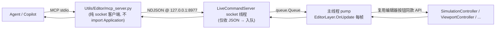

# 编辑器实时命令总线 / MCP 热注入协议（Editor Live）

> 适用：`Application/Editor/Services/LiveCommandServer.py`（编辑器侧总线）、
> `Utils/Editor/**`（agent 侧 MCP 服务器与安装）、`Application/Editor/EditorLayer.py`（pump 接入点）、
> `Application/Editor/EditorPlugin.py`（启停接入点）。
> 目标：让 agent 像操作 Fusion360 一样**实时操作运行中的编辑器**（热注入，非文件式）。

---

## 1. 架构与线程纪律



**硬约束（free-threading 无 GIL）**：
- socket 线程只做 JSON 编解码 + 入队 + 等待回执；
- **一切编辑器状态变更只在主线程 `pump()` 执行** —— 与人类点击走完全相同代码路径；
- 每帧限量（16 条）保证帧率；单条命令回执等待上限 15s。

## 2. 端点与配置

| 项 | 值 |
|---|---|
| 地址 | `127.0.0.1:<port>`（**仅回环**，外部网络不可达） |
| 端口 | 默认 `8977`；环境变量 `MGE_EDITOR_MCP_PORT` 覆盖（编辑器与 MCP 两侧都读） |
| 启动 | 编辑器加载时由 `EditorPlugin.on_load → LiveCommandServer.start()` 自动启动 |
| 停止 | `EditorPlugin.on_unload → stop()`；daemon 线程随进程退出 |
| 端口占用 | 打印 `[Live] WARNING: cannot bind ...` 并禁用（不阻塞编辑器） |
| 审计日志 | 每条命令在主线程打印 `[Live] id=<n> op=<op> → ok / ERR ...` |

## 3. 协议（NDJSON）

一行一条 JSON；请求-响应一一对应：

```json
请求:  {"id": 1, "op": "sim.play", "args": {}}
回执:  {"id": 1, "ok": true,  "result": {"requested": true, "state": "pending_start"}}
错误:  {"id": 1, "ok": false, "error": "ValueError: unknown op: 'foo' (available: ...)"}
```

- `id`：任意值原样回传（int/str）；
- 非法 JSON → `{"id": null, "ok": false, "error": "invalid request: ..."}`；
- 主线程超时未消费 → `{"ok": false, "error": "timeout waiting for editor main thread"}`。

## 4. op 表（v1 — 最小验证集 3 条）

| op | MCP 工具 | args | 语义（等价的人工操作） | 响应 |
|---|---|---|---|---|
| `sim.play` | `editor_run_pie` | — | 点 **Run** 按钮：请求 PIE 启动（帧末消费） | `{requested, state}` |
| `view.set_mode` | `editor_switch_2d` | `{"mode": "2d"\|"3d"}` | 视图工具栏 **2D/3D** 按钮 | `{mode, label}` |
| `editor.quit` | `editor_quit` | — | 点窗口 **X**（走 GLFW 正常关闭流程；无窗口回退 `run_state=False`） | `{closing, via}` |

设计约定：
- **一切 op 复用编辑器现有 API**（不绕过控制器直接改状态），保证与人工操作行为一致；
- 后续新增图片/帧类 op 时注意：重活（编码等）不得阻塞渲染/主线程 —— 见 §9 路线；
- `validate_only`（空跑）为后续阶段预留（与节点图 dry-run 同哲学），v1 未实现。

## 5. MCP 侧（agent 工具）

- 文件：`Utils/Editor/mcp_server.py`（FastMCP，stdio）；**纯 socket 客户端，不 import Application**（测试守卫生效）；
- 编辑器未运行时返回人话错误：`编辑器未运行（127.0.0.1:8977 无监听）— 请先启动 startup.bat。`
- 注册：`.venv-py314t\Scripts\python.exe Utils/Editor/install_mcp.py` →
  写入工作区 `.vscode/mcp.json`（名称 `engine-editor-live`，command=venv python）→ **重载 VS Code 生效**；
  卸载：`... install_mcp.py --uninstall`。

## 6. 新增一个 op 的步骤（扩展清单）

1. `LiveCommandServer._register_ops()` 里注册 `"域.动作": cls._op_xxx`；
2. 实现 `_op_xxx(args) -> dict`（**主线程**执行；只调编辑器 API/控制器；错误直接 raise，pump 会转成受控错误）；
3. `Utils/Editor/mcp_server.py` 加一个 `@mcp.tool()` 薄包装（→ `_send("域.动作", args)`）；
4. 测试：`Test/Application/Editor/test_live_command_server.py` 加一条往返断言；
5. 更新本文档 op 表。

## 7. 故障排查

| 现象 | 原因 / 处理 |
|---|---|
| MCP 工具报"编辑器未运行" | 编辑器没开 / 端口被环境变量改了两侧不一致 / 启动日志里有 bind 失败 |
| 工具一直超时 | 编辑器主线程被卡住（如 modal 操作）；看编辑器控制台 `[Live] id=...` 是否有输出 |
| 端口占用 | 改 `MGE_EDITOR_MCP_PORT`（两侧同时设）或关掉占用进程 |
| `.vscode/mcp.json` 不生效 | 重载 VS Code 窗口；或 Command Palette → `MCP: List Servers` 手动重启 |

## 8. 测试与验收

```powershell
# 无头回环测试（真 socket + 手动 pump; 不需要 GUI）
.venv-py314t\Scripts\python.exe Test/Application/Editor/test_live_command_server.py
```

人工验收（编辑器运行时）：
1. 启动 `startup.bat`，控制台应出现 `[Live] Editor command server on 127.0.0.1:8977`；
2. agent 调 `editor_switch_2d` → 视口切 2D；`editor_run_pie` → 启动 PIE；
   `editor_quit` → 编辑器退出；控制台逐条可见 `[Live] ...` 审计行。

## 9. 路线（后续阶段）

- **阶段 2**：图编辑 ops（graph.add/connect/remove）、`sim.stop/pause`、`scene.save`、
  `view.screenshot`（渲染线程抓帧 → MCP 图片内容块）、帧环形日志（"实时图像=调试日志"：抓帧在渲染线程、
  PNG 编码在后台线程）。
- **阶段 3**：事件推送（选中变化 → MCP 通知）、只读开关、多客户端、`validate_only` 空跑。
