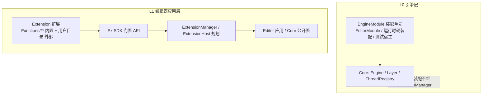

# 扩展体系架构协议（Extensions Architecture）

> 状态: **已执行（2026-10-11）** — §2 改名已落地（旧名 shim 过渡）; §7 M0 骨架已交付（实装地图见 `Doc/ExtDev/extension_dev_protocol.md` §13）。本文档职责 = 归档"三层高度模型 / Plugin 审计与决议 / 切入架构"。
> 关联: `ui_protocol.md` §10（Action 契约）· `threading_protocol.md`（线程纪律）· `device_io_protocol.md`（品牌进程）· `project_export_protocol.md`（打包分发）· `runtime_packaging_protocol.md`（导出物）

---

## 1. 三层高度模型（依赖方向铁律）

三个概念、三个高度、**绝不混用**：

| 层 | 名称 | 代码域 | 使用者 | 生命周期 | 对外可见? |
|---|---|---|---|---|---|
| L0 | **EngineModule**（宿主装配模块, 现名 Plugin — 见 §2） | `Application/Core/` + 各宿主（EditorHost/GameRuntime/测试宿主） | Engine 子类 | 引擎启动/关闭 | 否 — 引擎内部概念 |
| L1 | **Extension**（扩展） | `Functions/**`（内置）+ 用户扩展目录（外部, 规划） | 编辑器应用（ExtensionManager, 规划） | 编辑器运行时可启停 | **是 — 对外开发者唯一说法** |
| L2 | **Mod**（运行时内容） | 未定义（parked） | 播放器/导出游戏 | 游戏启动 | 未来（v1 明确不做） |

**依赖方向铁律**：
1. Extension → ExtSDK → Editor/Core（单向）；
2. Core/Editor **禁止** import Extension（唯一例外：ExtensionManager 按 manifest 动态导入扩展入口）；
3. 外部扩展**禁止** import `Application.Editor/**` / `Application.Core/**` 内部（静态守卫，§6）；内置扩展（同仓同版本发布）允许内部引用，但必须走既定注册缝；
4. L0 装配单元只允许 Engine 层代码实现/使用。

一句话：**EngineModule 与 Engine 骨架同层（装配）；Extension 与编辑器应用同层（功能模块）；Mod 与导出游戏同层（内容）。** 三者的清单格式、生命周期、权限模型、命名空间都不同，禁止互相借用。

---

## 2. Plugin 审计与重构决议

### 2.1 现状审计（2026-10-11 实测）

| 观测点 | 事实 | 证据 |
|---|---|---|
| 定义 | `Application/Core/Plugin.py` ABC：`on_load/on_unload/get_layers` | 全文 90 行 |
| 唯一子类 | `EditorPlugin` = LiveCommandServer 启停 + 5 个编辑器 Layer 清单 | `Application/Editor/EditorPlugin.py` |
| 唯一调用链 | `EditorHost.init() → load_plugin(EditorPlugin()) → run()` | `Application/EntryPoint.py:11-16` |
| 宿主侧接线 | `EditorHost.load_plugin`（on_load → 逐 Layer push_layer → 持有实例）；`Engine.shutdown → _unload_plugin()` 钩子 | `EditorHost.py:333-365`、`Engine.py:473/484` |
| **运行时/导出链** | **零使用** —— PlayerBootstrap / GameRuntime / 测试宿主全部直接 `push_layer(...)` 硬装配 | `SimulationController.py:281`、`PlayerBootstrap.py:345`、`test_pie_bare.py:88` |
| docstring 承诺 | `"PluginManager"` **不存在**；"未来: 音频/网络/物理插件" 零落地 | `Plugin.py:19-25/53` |

**结论**：
- Plugin 与 Extension **不是一个高度的设计**：前者坐在 Engine/Core 层（宿主骨架装配），后者是编辑器应用层的功能模块。把 mod/设备接口塞进 Plugin 会造成 Core 层反向依赖业务与外部代码 —— 上下依赖关系崩坏（用户判断成立）。
- **命名债成立**：`Plugin` 一词抢占了对外开发者语境中的"插件"语义，实际语义为"某宿主的装配清单"；且"唯一宿主 + 唯一子类 + 虚假未来承诺"三重证据。
- 但它是**真实存在的缝**：启动/卸载对称钩子 + 装配单点（`EntryPoint` 三行可读性依赖它）。

### 2.2 决议提案（待拍板）

1. **概念保留，改名让词**（推荐 `EngineModule`；备选 `EngineAssembly` / `HostBundle`）：
   - `Application/Core/Plugin.py` → `Application/Core/EngineModule.py`（类名 `EngineModule`）
   - `Application/Editor/EditorPlugin.py` → `EditorModule.py`（类名 `EditorModule`；**过渡期保留 `EditorPlugin` / `Plugin` 旧名别名 ≥1 个版本**）
   - 让出的"插件/Plugin"一词对外统一由 **Extension** 承接；运行时内容层预留 **Mod**。
2. **职责收窄并写死文档**：EngineModule = "启动钩子（on_load/on_unload）+ Layer 与服务清单（get_layers）"；**只允许 Engine 层代码实现/持有**；禁止扩展代码实现它。
3. **留存必要性结论：保留（改名+收窄）> 删除**：
   - 删除代价：`EditorHost.init` 增生硬编码层栈 + 失去启动/卸载对称钩子位；
   - 保留代价：1 个 ABC + 1 个实现 ≈ 零维护；且未来多宿主（headless 测试宿主等）复用同一缝。
4. **装配对称化（可选议题）**：GameRuntime 硬装配**保持不变**（推荐）——文档承认两种合法装配：*最小宿主允许硬装配；复杂度宿主走 EngineModule*。若未来第 3 个宿主出现再收敛。
5. **迁移清单（低风险, ~8 处）**：`Plugin.py`（改名+docstring 重写）→ `EditorPlugin.py`（基类+改名）→ `EditorHost.py`（import/字段/`load_plugin` 签名）→ `EntryPoint.py` → `Engine.py`（`_unload_plugin` docstring）→ `Doc/Dev/README.md` 地图行 → 仓库记忆。
6. **执行状态（2026-10-11 已落地）**：`EngineModule` / `EditorModule` 为正式名;
   `Plugin.py` / `EditorPlugin.py` 为过渡 shim（≥1 版本后移除）; `EditorHost.load_module / unload_module`
   生效（`load_plugin / unload_plugin` 保留弃用别名）; `Engine._unload_module` 钩子就位; EntryPoint 已切新名。

---

## 3. 切入架构 — 三档侵入模型

**原则：扩展点必须"要么不侵入，要么侵入在架构指定的缝"。** 开发者自由度来自"缝的丰富度"，而不是来自越界。

| 档 | 名称 | 适用 | 机制 | 风险 |
|---|---|---|---|---|
| T0 | 声明式贡献（默认） | 面板 / 命令 / 菜单 / 设置 / 节点包 / 日志 / 线程 | manifest 声明 + `ctx.*` 注册 API；宿主物化；**扩展零改 App 文件** | 极低 |
| T1 | 受控侵入（Hooks） | 需要包裹/接管既有行为 | 架构**预定义** hook 点；链式中间件（多订阅, around）与单槽接管（显式 takeover + 冲突检测）分离；全部带 owner 标注 | 中（有边） |
| T2 | 进程外（设备/重依赖） | 硬件接口、大依赖、独立 env | 品牌服务进程（现有 `ServiceHost/ServiceClient` 模式）+ RPC；SDK 只发客户端 | 零共享内存 |

### 3.1 T1 Hook 目录（初版 — 每个 hook 都是"允许人侵入"的正式入口）

| hook | 形态 | 语义 |
|---|---|---|
| `ui.menu.contribute` | 链式 | 向指定菜单/右键菜单追加条目（owner 标注） |
| `ui.overlay.post_draw` | 链式 | 帧末 overlay 绘制（NDC/屏幕空间） |
| `keymap.register` | 链式 | 快捷键注册（冲突检测 + 优先级） |
| `scene.entity.created / deleted` | 链式通知 | 场景变更事件 |
| `node.exec.pre / post` | 链式中间件 | 节点执行包裹（可改输入、观测输出） |
| `node.rules.add` | 链式 | 图校验规则追加（graph_constraints 扩展） |
| `settings.migrate` | 单槽 | 扩展设置 schema 升级（接管需显式声明） |

### 3.2 侵入纪律（写入开发者文档；部分可被守卫检测）

- **允许**：上述 Hook 点；`ctx.*` 注册 API；T2 RPC。
- **禁止**：运行时 monkey-patch 引擎/编辑器类（`setattr(核心类, ...)`）；替换注册表内部结构；直接改私有容器（如 `UIManager._panels`）；在渲染/主线程阻塞。
- 检测：边界测试静态扫描（§6）+ 评审清单 + quarantine 事故归因。

---

## 4. 兼容与破坏面削减机制（跨扩展兼容性）

| # | 机制 | 说明 |
|---|---|---|
| 1 | **SDK 门面为唯一依赖面** | 外部扩展只 import ExtSDK；内置扩展允许内部引用但必须走注册缝 |
| 2 | **命名空间** | 所有贡献 id 强制 `ext.<id>.` 前缀；节点 type = `ext.<id>.<type>` |
| 3 | **冲突检测** | 重复 id / 单槽 hook 竞争 → 加载期报错并归属责任方；接管需显式声明 |
| 4 | **能力声明** | manifest `capabilities`（ui/device/fs/net/scene_read/scene_write/threads）→ `ctx` 按声明发放，未声明不可达 |
| 5 | **版本闸门** | `api_version` semver + `min_engine`；不匹配 → 菜单灰显 + 明确原因 |
| 6 | **异常遏制三级** | 加载失败 → broken（列于菜单并显示原因）；绘制异常 → 该窗口本帧跳过 + 计数；线程崩 → 扩展级 quarantine，引擎不受影响 |
| 7 | **确定性加载** | `requires` 拓扑排序 + 名称稳定排序，加载顺序可复现 |
| 8 | **贡献审计** | Extensions 管理面板 + 生成式贡献清单（docgen 式，学 `ops.md`） |
| 9 | **Action 契约延伸** | 扩展命令进 `ui_protocol.md` §10 映射表（owner = `ext:<id>`），MCP/CLI 天然可驱动，守卫测试自动覆盖 |

---

## 5. 贡献点目录（开发者能力面）

### 5.1 设计面板（用户点名场景）

- `ctx.ui.register_window(id, title, draw_fn, *, default_size, dockable)` —— 绘制发生在 `UIManager.draw_all` 帧内（**渲染线程**）；扩展不持有 imgui context、不自行 render。
- 控件 kit（封装层）：`SignalScope`（环形缓冲→implot 实时曲线）、`SchemaPanel`（schema→自动控件）、`DevicePanelTemplate`（连接/开关/设备号/阻抗表）。
- `ctx.ui.post(fn)`：后台线程 → 渲染线程帧安全点（跨线程触碰 UI 状态的唯一通道）。
- 异常纪律：draw_fn 异常 → 捕获 + 本帧跳过 + 连续 N 帧 → quarantine（§4-6）。

### 5.2 节点编辑器新节点层级（用户点名场景）

开发者提交 `NodePack` 声明，ExtensionManager 翻译到现有五注册点（**不新增注册机制**）：

| 声明内容 | 落位（现有机制） |
|---|---|
| 节点类型（引脚/props/标签） | `Core/NodeGraph/node_types` 注册表（动态注册） |
| 求值器回调 | `register_evaluator` |
| 引脚可见性规则 | `visible_pins` `@rule` |
| 卡片内联控件 | `widgets` `@register`（key 限定扩展前缀） |
| **Add 菜单层级** | `styling.MENU_SECTIONS` 新增**顶级页 = pack 名**（Extensions 区），页内可分组 |

- type 命名空间 `ext.<id>.<type>`；与内置同名 → 拒绝（除非显式 override 声明 + 警告记录）。
- 图校验规则经 `node.rules.add` hook 追加。
- 场景载入时扩展缺失 → 图内占位 "missing extension"（M3 交付）。
- 求值器运行在既有 evaluator 协议内（扩展文件位于扩展目录，注册回调），引擎不感知扩展源码。

### 5.3 其余贡献面（归入 M1/M2 交付）

命令（进 §10 契约）· 设置（schema 自动 UI + 持久化）· 线程（`ctx.threads.spawn` + ThreadRegistry 强制注册）· 日志通道（`ext.<id>` → Console 过滤）· 数据总线（RingBuffer 公共化）· 后台任务（`ctx.jobs.submit` → Future）。

---

## 6. 守卫与验收（计划）

| 守卫 | 形态 | 内容 |
|---|---|---|
| `test_extension_boundary.py`（M0 立项） | 静态扫描 | ① 外部扩展 import 白名单（仅 ExtSDK + stdlib）；② Core/Editor 不 import `Functions/**`；③ monkey-patch 模式黑名单检测（对核心类的运行时 `setattr`） |
| 契约守卫（复用） | 已有 | 扩展命令进 §10 → `test_action_contract` 三方一致自动覆盖 |
| 线程守卫（复用） | 已有 | `test_thread_boundary` SPAWN_SITES 增加扩展宿主路径；ThreadRegistry `ext:<id>:*` 命名强制 |
| 冒烟（M3） | 新增 | 最小示例扩展 headless 加载/启停/卸载零残留 |

---

## 7. 分期对接（与扩展蓝图 M0-M3）

- **M0（已交付 2026-10-11）**：改名执行 ✓ + `ExtensionBase` / `ExtensionContext` / `ExtensionManager` ✓ +
  Extensions 主菜单（列出/启停/broken 展示）✓ + `extension.list/enable/disable` ops ✓ +
  扩展 op 增量扫描注册表（`ext.<id>.*`）✓ + 四个默认扩展 manifest + TODO 建档 ✓;
  开发规范: `Doc/ExtDev/extension_dev_protocol.md`（实装地图为权威）。
- **M1**：UI API（register_window / register_command / kit / ui.post）+ Gtec "信号/阻抗/控制"三窗 demo。
- **M2**：线程 API（threads / jobs / tasks / bus）+ ThreadRegistry 集成 + "三分执行模型"开发者文档。
- **M3**：外部化（用户目录发现 / .mgext 安装卸载 / 设置存储 / 脚手架 / 示例扩展 / `extension_dev_guide.md` / 扩展测试协议）。

---

## 8. 拍板记录（2026-10-11）

1. **L0 改名选型**: `EngineModule`（已执行; 备份备选 EngineAssembly/HostBundle 未采用）。
2. **GameRuntime 装配对称化**: 保持硬装配 + 文档承认两种合法装配（默认按推荐执行, 可回调）。
3. **M0**: 已执行（改名 + ExtensionManager 骨架 + 菜单 + ops 通道 + 默认扩展建档）。
4. 上轮蓝图遗留 6 问: 默认按推荐执行 — UI 直通+封装双层 / 外部目录 M3 / 扩展命令进契约（ext.* 独立于核心表）/
   设备类默认进程隔离 / 保留 `Functions/` 目录名 / v1 范围仅编辑器扩展（Mod 不做）。
