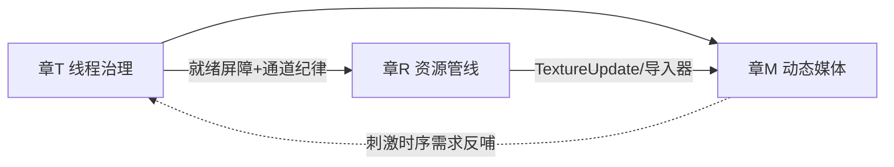

# 下一步愿景蓝图（待联合评估 — 草案 v1）

> 状态：**草案（2026-10-05）**，未开工。三章独立可评估、可裁剪；每章含 现状实证 / 功能归属 / 依赖选择 / 里程碑。
> 章节代号：**T**=线程治理, **R**=资源系统, **M**=动态媒体。

---

## 章 T — 线程治理 + 竞态/压力测试体系

### T.1 现状（实测盘点）

| 线程 | 归属 | 职责 | 同步机制 |
|---|---|---|---|
| `Engine._render_loop` | `Core/Engine.py` | Layer.OnAttach → 渲染帧 | `run_ready` 事件放行 |
| `Engine._logic_loop` | `Core/Engine.py` | 每帧全 Layer.OnUpdate | 与 OnAttach **并发** |
| `LiveCommandServer` accept + 每客户端线程 | `Editor/Services` | agent 热注入 | 主线程 pump 消费 |
| 校验 worker | `NodeGraph/validation/service.py` | 干跑任务 | 单活动任务槽 |
| `bci-<name>` | `Functions/BCIAlgorithm/Jobs.py` | 训练同步等待 | 锁保护结果槽 |
| `gtec-acq` / `spd-io` / ServiceClient reader | `Functions/**` | 设备采集 | 各自队列/锁 |

已有纪律：`runtime_packaging_protocol.md` §3.1（"就绪标记最后赋值" + 类级默认值）；先例回归
`test_runtime_node_layer_race.py`（受控阻塞点，确定性复现半初始化窗口）。

### T.2 问题定性（"偶发启动不加载内容"的机理归类）

`SimulationController._try_consume_start` 链：主线设 canvas/scene → `GameRuntime.start()`（主线）→
运行时**跨线程**起 render/logic；`sync_scene_from_host` 在 start 内执行且 `except → print` **吞错继续**。
症状类别 = ① 无"内容就绪"门（PIE 可能在注册完成前跑帧）× ② 异常静默（吞错→部分加载）× ③ 无压力面
（偶发竞态无确定性复现）——三者叠加才叫"偶发"。

### T.3 蓝图（四件套）

1. **`Doc/Dev/threading_protocol.md`（新）** = 单一事实源：
   - 线程清单 + **触达矩阵**（每线程 × 它可写的子系统；"谁可以在哪一刻写下什么"）；
   - 三种合法跨线程通道：命令队列（enqueue）/ 不可变快照（FrameCaptureSlot 型）/ 阻塞任务槽（SyncJob 型）；
   - "半初始化窗口"通用契约（§3.1 升格为全文）；吞错禁令（启动链 except 必须上抛或置错误态）。
2. **启动/就绪状态机**：`BOOT → LOADING → REGISTERED → READY → RUNNING`，PIE 启动等待 READY 屏障
   （超时→显式报错，而不是静默空场景）；`sync_scene_from_host` 失败置错误态。
3. **压力测试层**：`Test/Application/stress/` + runner `--stress N`（重复扰动：可控阻塞点/随机 sleep 注入）；
   首批准入用例 = ① RuntimeNodeLayer 半初始化 ② host-sync 时序 ③ LiveCommandServer 泵并发 ④ 校验服务
   单任务槽竞争。指标：N 次全部通过 + 失败时留线程时间线日志。
4. **边界守卫测试**（core 档）：触达矩阵 ↔ 源码扫描（如"evaluators 零 threading 依赖"、
   "Layer 类共享态必须有类级默认值" 的静态检查）。

### T.4 依赖 / 归属 / 里程碑

- 新依赖：**无**（stdlib threading + 现有 runner）。
- 归属：`Doc/Dev/threading_protocol.md`、`Core/Engine.py`（就绪屏障）、`Runtime/GameRuntime.py`、
  `Editor/UI/controllers/SimulationController.py`、`Utils/Dev/test_runner.py`（--stress）、`Test/Application/stress/`。
- M1 文档+触达矩阵+静态守卫测试 → M2 就绪屏障 + 吞错禁令落地（先修"不加载内容"）→
  M3 stress 运行器 + 4 个准入用例 → M4 接 CI 形态（core 档固定跑 1 个 stress 用例）。
- **执行完毕（2026-10-05）**：M1-M4 全部落地 —— ThreadRegistry/接线/探针/协议（M1）；READY 屏障 +
  吞错禁令 + `last_error` + 逻辑限帧 63kHz→240Hz（M2，`test_pie_bare` 33s→11.5s）；`--stress N` 运行器 +
  并发压力用例（M3）；启动点白名单边界守卫（M4）。core 22/22（含媒体 M1）。剩余可选：校验服务单任务槽竞态用例、Layer 共享态静态检查。

---

## 章 R — 资源导入管线（多格式 + 面板块 + 反崩溃测试）

### R.1 现状（实测）

- `ResourceManager.py`：**trimesh** 加载 `{obj, gltf, glb, stl, ply, off, fbx, dae, 3ds}`（声明 9 种）；
  PIL 加载纹理（png/jpg/bmp/tga/hdr）。**声明 ≠ 实际可载**：fbx/dae/3ds 需 trimesh 的 assimp 后端，
  当前环境必失败——能力矩阵从未验证过。
- `ResourcePanel.py` 443 行（toolbar/分类页/网格/卡片/状态栏）= 有骨架、半桶水（无缩略图/无拖入/无异步）。
- 测试面：**零**（上轮刚清掉旧 demo；格式加载、损坏文件、面板交互均无系统化覆盖）。

### R.2 蓝图（导入器注册表是核心）

1. **Importer 注册表**（`Application/Resource/importers/`）：`扩展名 → Importer(probe/load→IR)`；
   统一入口 `ResourceManager.LoadAsset(path)`；**能力矩阵自动探测**（启动时 probe 依赖后端，未支持格式
   显式给出 "needs assimp" 而非炸链路）。
2. **错误遏制契约**：导入失败 = 返回错误对象 + 面板提示，**绝不抛出到绘制循环**（对照上轮实锤：
   epoch widget 一画就炸 = 缺乏遏制类测试的下场）。
3. **异步/延迟加载**：>N MB 网格走后台线程 + 完成后 GPU 注册（复用命令队列通道；与章 T 的通道纪律衔接）。
4. **ResourcePanel v2**：缩略图（离屏渲染，FBO 基础已具备）、拖拽导入、分类/搜索、错误态展示；
   （与 `ui_refactor_plan` 联动拆分，面板本身 ≤500 行）。
5. **测试体系**：`Test/Resources/corpus/`（每种格式 1 小样本 + 故意损坏 5 类）+ `test_importers.py`（core）
   + 面板场景（gui）+ 大文件异步用例。

### R.3 依赖选择

| 候选 | 用途 | cp314t 风险 | 建议 |
|---|---|---|---|
| trimesh（已有 4.12.1） | obj/gltf/glb/stl/ply/off | 已装可用 | **保留为底座** |
| pyassimp | fbx/dae/3ds | 高（native 轮子） | **暂缓**；能力矩阵先如实标注"未支持" |
| （无其他新增） | — | — | 章 R 原则上零新增依赖 |

### R.4 归属 / 里程碑

- 归属：`Application/Resource/importers/**`（新）、`ResourceManager.py`（瘦身成门面）、
  `Editor/UI/panels/ResourcePanel.py`、`Test/Resources/corpus/`、`Test/Application/Resources/`。
- M1 注册表 + 能力矩阵 + corpus（obj/glb/png 三格式打样）→ M2 全格式接线 + 错误遏制契约 +
  core 测试 ≥3 格式 × ≥3 损坏类 → M3 异步加载 → M4 面板 v2（缩略图/拖拽）+ 场景回放。

---

## 章 M — 动态媒体（GIF / 视频 / 音频）

### M.1 现状

零代码。可用底盘：**Pillow**（GIF 逐帧，已在依赖）× **pysdl2 + pysdl2-dll**（SDL2 **音频 API** 随装有）
× **cffi**（sounddevice 兼容）× scipy/numpy（波形）。渲染侧纹理上传链已有，缺"逐帧更新"命令。

### M.2 蓝图（按"零新依赖 → 低风险新依赖"推进）

1. **M1 图像/GIF（零新依赖）**：`Functions/Media/` 可选扩展（对齐品牌策略：`AssetedMedia` 独立文件夹 +
   `[project.optional-dependencies] media = [...]`）；节点 IO▸Media：`ShowImage` / `ShowGif`
   （Pillow seek 帧 → Texture2D 逐帧更新）；渲染侧新增 `TextureUpdateCommand`。
2. **M2 音频**：`PlaySound` / `PlayTone`（波形生成走 scipy/numpy）+ 设备枚举/延迟参数；
   评估 **sounddevice**（低延迟回调、回环测试友好）vs **SDL2 音频**（零新依赖）二选一（见评审问题 Q4）。
3. **M3 视频**：`PlayVideo`（解码帧流 → 同一 Texture2D 更新通道；循环/区域/音量）；
   解码器选型见下表；**帧时间戳 → 事件触发器对齐**（BCI 刺激范式的核心需求，与 Gtec/SigGen 触发同帧域）。
4. **测试**：解码确定性（帧数/时间戳）、场景截图（GIF/视频帧上屏，视觉证据）、音频单测（波形/时长）+
   人工听感清单；实机 e2e：媒体节点图 → 截图对比（沿用 `view.set_grid` 验收模板）。

> **载体设计（2026-10-05 v2 — 业界对照）**：视频/动图在引擎里的标准形态 = **每帧被更新的纹理**
> （Unity: VideoPlayer → RenderTexture → 任意 Material 采样；Unreal: MediaPlayer → MediaTexture → 材质参数；
> three.js: VideoTexture → map）。直接照抄的方案：**媒体系统只产"动态纹理"；载体 = 普通实体**:
> - 广告牌 = Entity[Transform + MeshRenderer(Quad) + Material(texture = media)]；
>   尺寸 = quad 原尺寸 × Scale，位置/旋转全归 Transform（媒体系统不碰 Transform）；
> - 宽高比 = 材质层 fit 模式（stretch 默认 / contain / cover；UV 变换实现，业界同款）；
> - 第二消费面 = 全屏 overlay（BCI 视觉刺激用；不挂实体）；
> - 真"广告牌（billboard 朝向相机）"是独立小功能（旋转跟随相机），与媒体解耦，后加。
> 落地链：`TextureUpdateCommand`(Renderer) ← MediaTexture（每帧上传）← 解码器（GIF→Pillow；视频→imageio-ffmpeg）。
> 分工：**组件（VideoPlayer / AudioSource）= 状态载体**（可序列化 / 进 Inspector / ResourcePanel 拖入）；
> **节点 / MCP = 控制面**（Play/Stop/Seek 操作组件）——与 MeshRenderer 既有模式一致。

### M.3 依赖选择（cp314t 轮子是硬约束）

| 候选 | 用途 | cp314t 风险 | 建议 |
|---|---|---|---|
| imageio + imageio-ffmpeg | 视频解码（ffmpeg 以**独立 exe**分发，不挑解释器） | **低** | **首选** |
| sounddevice | 音频输出/回环 | 低（cffi + DLL 轮子 py3-none） | 首选（Q4 评估） |
| SDL2（已有 pysdl2） | 音频输出备选 | 零 | 备选 |
| PyAV | 精细解码控制 | 中（需 cp314t 轮子) | 观察 |
| opencv-python | 视频 | 高（体积+轮子） | 缓 |

### M.4 归属 / 里程碑

- 归属：`Application/Functions/Media/**`（新, 可选扩展）、`Core/Renderer`（TextureUpdateCommand）、
  节点族（node_types/evaluators/widgets 的 media 子模块——正好接 widgets 拆包后的结构）、
  `Test/Application/Media/`、时间对齐文档进 `device_io_protocol.md`（触发域）。
- M1 GIF/图像（含节点+测试）→ M2 音频 → M3 视频+触发对齐 → M4 文档/e2e/打包评测（wheelhouse 增补）。

### M.1 执行记录（GIF 先行版, 2026-10-06）

- **已落地（≠ 原蓝图的"节点先行"，改为组件+实机 e2e 先行）**：`MediaPlayer` 组件（参数载体）+
  `MediaRuntime`（解码/时钟/纹理协调, logic 线程 tick）+ `TextureUpdateCommand` 命令链 +
  `CreateTextureFromArray` + 单一注册修复（`ensure_defaults` 死代码激活）。
- 验收：core `test_gif_clip` 17/17；实机 e2e 三连抓帧动画实锤（5753/8856 px 区域变化）；
  `Examples/meme_gif_2d.scene` 存档 + 重载往返完整。协议: `media_protocol.md`。
- 剩余：fit contain/cover（材质 UV）、动态纹理引用释放（场景频繁重载时）、
  MediaPlayer 模板组件白名单通用化评估；后续 M2 音频 → M3 视频+触发对齐 → M4 打包评测。

### M.1 修订 v2（同日晚 — 用户决议：单一运行时 + 模板语义）

- **移除编辑器侧媒体 tick**：编辑器编辑 = 模板；**PIE 唯一由 GameRuntime 控制**。
  `MediaRuntime` → **`MediaSystem`**（无独立循环; 由节点每帧 `advance(engine, eid, dt)`, 引擎帧去重）。
- **新节点 IO ▸ Media ▸ Show Media（ShowMedia）**：五注册点 + 双向静态校验（`media_pin_unconnected`
  error / `media_exec_unconnected` warning）+ rules.md / graph_rules.py / GraphBuilder.show_media。
- PIE 语义实测: 编辑器实体 = EntitySpawn **模板**（PIE 不直接渲染）; 生成的实例由
  EntityGet → ShowMedia 驱动; `SimulationController._sync_ecs_to_scene` 模板白名单补 MediaPlayer。
- 实机 e2e: 模板视图 39.5KB（无播放）→ Run → PIE 三连抓帧 diff **28576 / 31942 px**（区域≈252×269）→ Stop 后编辑器视图逐字节回到模板（39546 = 39546）。
- core **23/23**；演示场景 `Test/TestProject/Test/scenes/meme_gif_2d.scene`（实体 + 8 节点图 + 2d 全序列化）。

---

## 章 G — 渲染体系（验证体系已交付 + 能力对齐蓝图）

### G.1 现状盘点（2026-10-06，与验证体系同批）

- **已交付**: 三层验证体系（core 契约 17 + 布局快照 24 + GL 像素 21 checks）+ `rendering_protocol.md`
  + agent 工具（op `renderer.snapshot`（48 ops）/ CLI `probe` 裸帧像素采样 / e2e 15/15, GL 4.4 NVIDIA）。
- **修复**: `update_highlight_config` 桥接缺失（命令契约与实现脱节 —— 由新测试抓出）。
- **基线**: core 26/26；探针世界→像素映射金标准已由用例锁定（12px/单位 @half_h=10）。

### G.2 learnopengl 差距表（“现代仍常用”子集 — 非商业引擎对标）

| 主题 | 现状 | 本引擎需求(范式/实验) | 优先级 |
|---|---|---|---|
| 着色器/纹理/变换/双相机/深度 | ✅ | 核心 | — |
| 拾取 FBO / 高亮后处理 / overlay 系统 / 抓帧 | ✅ | 编辑器与验证 | — |
| **实体混合(透明)+排序** | ✅ **已交付**（P1, 2026-10-06: `Material.blend` opaque/alpha + 透明由远到近 painter + 状态恢复; `test_gl_pixels` §9） | 刺激叠加/淡入淡出/半透明提示 | — |
| **FBO/离屏渲染目标通用化** | ✅ **已交付**（P1, 2026-10-06: `OpenGLRenderTargets` + 3 命令; rt_id=纹理ID 可直接采样; `test_gl_render_targets`） | 视频墙/刺激合成/后处理底座 | — |
| **基本光照**（环境光 + 1~N 平面光 + 点光, Blinn-Phong; 顺带解决 normal 浪费） | ✅ **已交付**（P1, 2026-10-06: 光照体系; 2026-10-07: `Light` 组件化（平面光/点光开关）+ 点光衰减 + 组件字段钳制; `test_gl_lighting`/`test_component_clamps` 数值锁定） | “有渲染引擎样”的立体感 | — |
| MSAA / UBO 合批 / 色调对比后处理 | ❌ / ❌ / 🔶(1 效果) | 视觉质量 & 大量实体性能/刺激对比度 | P2（按需求佐证） |
| 立方体贴图与天空盒 / 阴影映射 / 实例化 | ❌ | 可选氛围/规模 | P3（观察） |
| 模型导入扩展（glTF 已有 trimesh 路径） | 🔶 | 实验刺激物 | P2（与章 R 联动） |
| sRGB/色彩管理 | ❌ | 颜色保真 | P3（观察） |

### G.3 里程碑建议

- **G0 = 已交付**（验证体系+协议+工具；除 highlight 修复外零渲染行为变更）。
- **G1 = 已交付**（2026-10-06 P1 推送）：① 实体混合+排序（per-material blend + painter）✅
  ② FBO/离屏目标通用化（`OpenGLRenderTargets` + Create/Destroy/SetSceneTarget 命令）✅。
- **G2 = 已交付**（同上）：基本光照（DirectionalLight 组件 + 场景环境光 + Lighting shader
  Blinn-Phong；normal 正式启用；默认场景 Sun + DefaultLit 材质。后于 2026-10-07 组件更名为 `Light`
  并扩展点光）。**shader 设计规范**（用户
  预期缺口）：`shader_protocol.md` 已建立。
- **G3**: 按需求选做 MSAA / UBO 优化 / 后期效果 / 阴影 / 天空盒（每步准入 = 沿用本章验证体系：
  core 契约 + GL 像素用例 + e2e 最小断言；新字段可平滑扩展 `renderer.snapshot`）。

### G.5 P1 交付记录（2026-10-06）

- 新增命令: CreateRenderTargetCommand / DestroyRenderTargetCommand / SetSceneTargetCommand（13→16）。
- 新增组件: `DirectionalLight`（color_r/g/b + intensity; 方向 = Transform 局部 -Z）; 新 shader
  `Lighting`（保留 uniform 注入, 黑名单机制）; 新预置 `DefaultLight.prefab`（场景实体 "Sun"）;
  新材质 `DefaultLit`（默认 Cube; 用户实体仍用 unlit `Default` — SSVEP 色精确性）。
- 修复: **内置材质污染 bug**（`_ensure_unique_material` 内置模板永远先克隆; live 演示逮到,
  `test_material_isolation` 锁定）; 克隆体除名 `builtin_name`。
- 测试: core 29/29（含新三件: gl_lighting 11 + gl_render_targets 18 + material_isolation 11）;
  e2e 15/15; live 演示证据 `Test/_runs/p1_demo/`（默认场景/混合/光照截图 + snapshot）。

### G.6 光照组件化 + 字段钳制（2026-10-07）

- 组件改名: `DirectionalLight` → **`Light`**（`light_type` = `directional` 平面光 / `point` 点光 + `range`）；
  全链迁移: 别名 `DirectionalLight = Light` + `SceneSync._COMP_NAME_MIGRATIONS` + `PrefabManager._COMP_MAP` +
  `LiveCommandServer._migrate_type_name`（component.add/get/set 全路径）。
- 新渲染: 点光（至多 4）+ `uPointCount/uPointPos[4]/uPointColor[4]/uPointRange[4]`；衰减 att=(1−d/range)²，
  超距截断；无灯回退判定 = 平面光+点光计数均 0。
- 组件字段数值钳制: 单一权威 `ComponentRegistry.FIELD_CLAMPS` + `clamp_component_field()`
  （Inspector `set_component_field` / MCP `_op_component_set` 同口径; Light/Camera/Transform/MediaPlayer/TextDisplay）。
- 编辑器: 点光仅图标不画方向射线；图标状态哈希含 light_type/range。
- 测试: core 34/34（新增 `test_component_clamps` 25 checks; `test_gl_lighting` 16; `test_light_gizmo` 22）;
  e2e 证据 `Test/_runs/light_component_demo/`（5 抓帧 + 像素差分: 点光近/远 2964px 暖色偏移, 回近 0px 差 = 确定性）。
- 协议: `shader_protocol.md`（新）; `rendering_protocol.md` §2.5/§6/§7/§8 大幅更新。

### G.4 归属

- 协议 Sync: `rendering_protocol.md`（§6 发现表 / §7 矩阵随进度更新）；测试: `Test/Application/Renderer/**`。

---

## 跨章依赖与顺序

- T 先行（启动"偶发不加载"是当前最贵的隐性成本；且 R/M 的异步加载与帧流都吃 T 的通道纪律）。
- R 与 M 可交错：R 的 M1 与 M 的 M1 均为"零新依赖打样"，且 M 节点 widget 直接受益于 widgets 拆包结构。
- 每章独立验收、独立可停（不互相绑架）。

## 待联合评估的问题

- **Q1 顺序**：T→R→M 严格串行，还是 R/M 的"零依赖打样"先并进来抢一个快速可见成果？
- **Q2 章T 手段**：先立协议+压力面（测得出现象再修），还是先上 READY 屏障（直接堵漏）？（建议：M1/M2 同批做，压力面先行取证）
- **Q3 章R**：fbx/dae 值不值得为它引入 assimp（重 native 依赖）？还是矩阵标注"未支持"、用转换工具预加工？
  **倾向记录（2026-10-05）**：不引入 assimp —— glTF-first（静态+骨骼动画均走 glTF 规格）；FBX 走 Blender 离线转换；
  若未来必需则仅开发者侧 optional extra，**绝不进游戏运行时依赖**（用户零负担）。
- **Q4 章M 音频**：sounddevice（低延迟、易回环测试）vs SDL2（零新依赖）——实验范式对输出延迟的容忍度多少 ms？
- **Q5 章M 视频**：触发对齐需要到什么精度（帧级 / ±1ms / 硬件触发）？决定解码器与时间戳架构的复杂度。
