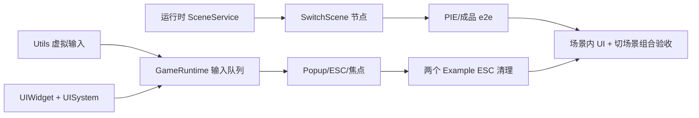

# 运行时场景 / 游戏内 GUI / 输入 — 下一阶段规划（v1）

> 状态：**B0（Utils 虚拟输入）已纳入下一迭代；A1-A3 / B1-B6 为默认方案，待复核**（2026-10-29）。本文件是设计讨论稿，不代表已实现。
> B0 先解决“agent 能像人一样操作编辑器/PIE/成品窗口”，再做 GameRuntime 输入层；两者都遵守同一坐标系与 ESC 语义。
> 关联：`node_editor_protocol.md`、`runtime_packaging_protocol.md`、`threading_protocol.md`、`rendering_protocol.md`、`text_protocol.md`、`media_protocol.md`。

## 0. 结论先行

建议把三条需求收成**两个工作流**：

1. **A — 运行时场景生命周期**：场景切换节点 + 运行时 SceneManager 的加载/替换/清理/重入。
2. **B — 运行时交互层**：游戏内 GUI + 输入事件 + 点击路由 + ESC/窗口策略。

GUI 和输入必须一起做：按钮点击、弹窗焦点、模态遮罩、ESC 关闭弹窗都依赖同一套事件消费顺序；拆成两个独立系统会重复实现命中测试和事件路由。

---

## 1. 现状（源码验证）

### 1.1 场景

| 能力 | 现状 | 证据 |
|---|---|---|
| 编辑器场景注册/切换 | 已有 | `Application/Editor/EditorHost.py`：`_scenes`、`switch_scene()`、`load_scene_from_file()` |
| 编辑器场景 ops | 已有 | `LiveCommandServer`：`scene.list/switch/create/save/load` |
| 场景数据容器 | 已有 | `Application/Core/Scene/Scene.py`：实体、node_graph、ambient、game_type、main_camera_entity_id |
| 世界重建 | 已有基础 | `SceneSync.sync_from_scene(clear_existing=True)` 删除实体、重建 ECS、重新入队 GPU 注册 |
| 运行时工程加载 | 仅启动场景 | `RuntimeProjectLoader` + `PlayerBootstrap.run()`：只加载 `startup_scene`，没有运行时场景列表/切换 API |
| 运行时场景节点 | **缺失** | `node_types/game.py` 只有 `CameraSetMain` / `ExitGame`；无 `SwitchScene` / `LoadScene` |
| 运行时场景生命周期 | **缺失** | `RuntimeNodeLayer` 只构建一次 `GraphEvaluator`；`OnDetach` 才停止图；无换场景后的 evaluator/template 重建 |
| 相机持久化 | **有缺口** | `SceneSync.sync_to_scene()` **跳过 Camera 实体**；场景文件无相机；运行时依赖 `CameraManager.create_defaults()`，`main_camera_entity_id` 可能为空 |
| 场景级背景色 | **缺口** | `background_color` 在 `game.json/.myproj` 层，不在 `Scene`；切场景不会自动改清屏色 |

### 1.2 游戏内 GUI

| 能力 | 现状 | 证据 |
|---|---|---|
| 编辑器 UI | ImGui（仅编辑器） | `Application/Editor/UI/**`；不应把 `imgui_bundle` 带入成品 |
| 运行时文字 | 已有 | `TextDisplay` 组件 + `TextSystem` + `SetText` 节点（`text_protocol.md`） |
| 运行时几何载体 | 已有 | `MeshRenderer` + `Material` + 2D 相机；可用于 quad 背景 |
| 拾取 | 已有基础 | 渲染器 pick FBO / `pick_at()`；但只服务场景实体，不是 UI 事件系统 |
| 运行时 overlay | 仅编辑器 overlay drawable | `OpenGLOverlays` / `Gizmo` 是编辑器渲染辅助，不是可序列化的游戏 UI |
| 布局/按钮/弹窗/焦点/z-order | **缺失** | Core/Runtime 无 `Button/Widget/Panel/Popup` 类型 |
| UI 节点 | **缺失** | 节点图没有 UI 事件/控件节点；现有 `SetText` 只能改文字 |
| 点击/悬停/禁用态 | **缺失** | 无命中测试缓存、无 pressed/hover/focus/事件消费 |

### 1.3 输入

| 能力 | 现状 | 证据 |
|---|---|---|
| GLFW 回调 → InputState | 已有 | `Application/Core/Input/InputPipeline.py` |
| 事件类型 | 已有 | `KeyboardButtonEvent` / `MouseButtonEvent` / `MouseMoveEvent` / `MouseGragEvent` / `ScrollerEvent` |
| 事件到 Layer | 已有 | `Engine._on_event()` 按层顺序派发，Layer 可 `consume()` |
| 运行时输入 Layer | **缺失** | `RuntimeLayer.OnEvent` 为空；`RuntimeDebugLayer` 会消费所有非静默事件；`RuntimeNodeLayer` 无 `OnEvent` |
| 输入节点 | **缺失** | 节点图没有 `OnKey*` / `OnMouse*` Event 节点 |
| ESC | 硬编码 | `glfwWindow._make_key_hook()`：Escape Release → `WindowCloseEvent`；不可由节点/工程配置 |
| GUI 点击路由 | **缺失** | 没有 UI 命中测试与“UI 先消费、场景后处理”的顺序 |
| DPI/坐标 | **有隐患** | GLFW 窗口坐标与 framebuffer 坐标可能不同；事件坐标未统一到 UI/拾取空间 |

---

## 2. 工作流 A — 运行时场景生命周期

### A.1 设计原则

1. **节点只发请求，不直接改 ECS/GL**：`SwitchScene` evaluator 只写 `ctx.scene_request`，由运行时在安全帧边界执行。
2. **切换是事务**：旧场景清理 → 载入新场景 → 相机/视口 → 节点图重启 → 首帧；任一步失败回滚/保持旧场景。
3. **PIE/导出同语义**：PIE 的运行时场景是副本，切换绝不改编辑器场景；导出成品从 `.myproj` 的 `scenes` 列表加载。
4. **一场景一图**：默认新场景用自己的 `node_graph` 重启 `OnGameStart`；跨场景持久变量需要显式设计，不默认继承。

### A.2 需要补的组件/API

- `RuntimeSceneService`（建议 `Application/Runtime/RuntimeSceneService.py`）：
  - `available_scenes()`：来自 `RuntimeProject.scene_list` + 路径解析；
  - `request_scene(name_or_path)`：只记录请求；
  - `apply_pending()`：逻辑帧边界执行事务；
  - `unload_current()`：实体/GPU/场景局部系统清理；
  - `load_scene()`：`RuntimeProjectLoader.load_scene()` + `SceneSync.sync_from_scene(clear_existing=True)`；
  - `restart_graph()`：重建 `RuntimeNodeLayer` 的 canvas/template/evaluator。
- `GameRuntime` 持有当前 `RuntimeProject`（目前 `PlayerBootstrap` 持有后未注入运行时），否则无法解析其他场景。
- `RuntimeNodeLayer` 增加“换图/重启”API，而不是只靠类属性 `set_canvas`：
  - `replace_canvas(canvas, template_scene)`：停旧图 → 换 canvas → 新 `ExecutionContext` → `OnGameStart`；
  - 继续复用现有“类级默认值 + 最后赋值”线程纪律。
- `SwitchScene` 节点（Game 分类）：
  - 输入：`exec_in`、`Scene`（string：场景名或相对路径）；
  - 输出：`exec_out`（切换请求已接受；不是“已加载完成”）；
  - evaluator：`ctx.request_scene(scene)`，dry-run 只记录。
- 可选 `ReloadScene` / `GetSceneName` 数据节点；不在 MVP。

### A.3 清理清单（切场景时必须明确）

- esper 实体 + 父子关系 + `_sid_map` / `_eid_to_sid`；
- 渲染器 `registered_entities` / `_visible_entities` / VAO/VBO/EBO/纹理引用；
- `TextSystem` 的场景局部纹理状态；
- `MediaSystem` 播放状态、动态纹理；
- 设备/BCI 会话（策略：默认跨场景保留，项目配置可关；不能静默丢数据）；
- 旧 `GraphEvaluator` 的 timer/变量/节点状态；
- 相机 ID、game_type、环境光、背景色；
- 运行时输出目录当前会话（默认不因切场景改变）。

### A.4 里程碑

| 阶段 | 内容 | 验收 |
|---|---|---|
| A1 | `RuntimeSceneService` + `SwitchScene` 节点 + 安全帧边界 | 无头测试：请求→替换→实体/GPU 清理；旧图停止、新图 `OnGameStart` |
| A2 | 相机/game_type/背景色/模板重建 | 2D/3D/overlay 三种场景切换后首帧相机正确；2D 场景 2D 相机生效 |
| A3 | PIE + 导出成品 e2e | PIE 切换不污染编辑器；成品运行 `SwitchScene` 可见新场景；旧实体无残留 |
| A4 | 失败回滚/日志/诊断 | 场景缺失、加载失败、图校验失败时保留旧场景并报错；`scene.switch` 诊断可查 |
| A5 | 资源/媒体/设备策略 | 明确定义并测试跨场景保留/释放；无 GPU/纹理泄漏 |

---

## 3. 工作流 B — 游戏内 GUI + 输入

### B.1 UI 方案对比

| 方案 | 描述 | 优点 | 风险 | 建议 |
|---|---|---|---|---|
| **B1 实体化控件（推荐）** | UI = 普通实体 + `UIWidget` 组件；背景用 quad，文字用 `TextDisplay`；`UISystem` 处理布局/命中/事件 | 可序列化、可在场景面板编辑、复用 MeshRenderer/TextSystem、无新依赖 | 需要屏幕空间 UI 相机/渲染pass、UI 事件系统 | **MVP 首选** |
| B2 即时模式小工具 | 节点每帧构建 UI 命令，运行时 `UISystem` 立即绘制 | 节点搭建快、状态少 | 不可在场景中保存/编辑；与现有实体模板语义不一致；复杂交互难 | 作为后续“调试面板”补充 |
| B3 复用编辑器 ImGui | 把编辑器控件抽到运行时 | 开发快 | 依赖 `imgui_bundle`/ImGui，违背“不带重依赖”；编辑器与产品生命周期不同 | 不采用 |
| B4 Web/HTML UI | 内嵌 WebView/HTML | 表现力强 | 部署重、跨平台差、输入/渲染桥复杂 | 不采用 |

### B.2 B1 设计要点

- 新增组件（建议单一 `UIWidget` + 少量字段，避免组件爆炸）：
  - `widget_type`: `button` / `label` / `panel` / `popup` / `image`（MVP 前四者）
  - `anchor`: 屏幕锚点 + `offset`/`size`（像素或 0..1 归一化；MVP 用像素 + 参考分辨率）
  - `z_order`, `visible`, `enabled`, `modal`, `style`（背景色/圆角可选）
  - 文本继续用 `TextDisplay`（不在 UIWidget 重复字体/颜色字段）
- `UISystem`（运行时 Layer）：
  - 建立屏幕空间 UI 相机/正交投影；与游戏相机分开；
  - 每帧布局 → 命中测试（`UIRect` 缓存）→ hover/pressed/click；
  - z-order 排序；modal 拦截下层；
  - 维护 `focused_widget`；点击空白处清焦点；
  - 与输入 Layer 协作：UI 先消费鼠标事件，再给场景/节点。
- 渲染：
  - 优先复用现有 quad + `TextDisplay` + 2D/overlay 相机；
  - 若一个活动相机不够，新增 UI pass（独立 view/proj 或 overlay pass），不改现有场景相机语义；
  - 文字沿用 `TextSystem` 的纹理热更；DPI 用 framebuffer 尺寸。
- 节点（MVP）：
  - `OnButtonClick`（Event，输出 widget/name、exec）
  - `SetWidgetText`（复用 `SetText` 即可，不新增）
  - `SetWidgetVisible` / `SetWidgetEnabled`
  - `ShowPopup` / `ClosePopup`
  - 可选 `CreateWidget`（若允许运行时生成 UI；MVP 可只支持场景内预置 UI）
- 不做（MVP 外）：文本输入框、滚动视图、复杂布局、主题系统、动画/过渡、拖拽窗口。

### B.3 输入系统（与 UI 同一工作流）

#### B.3.0 输入层能否作为 Layer 接入 GameRuntime？——可以，且已有接入点

源码验证结论：**`RuntimeInputLayer` 可以直接作为 `Layer` 压入 `GameRuntime`**，不需要改 Engine 主循环：

- `GameRuntime` 是 `Engine` 子类，已有 `push_layer()` / `pop_layer()`；
- `Engine._on_event()` 按 **栈顶 → 栈底** 派发，Layer 可 `event.consume()`；
- `RuntimeWindow` 的键盘/鼠标钩子已经以 `engine=GameRuntime` 派发 `KeyboardButtonEvent` / `MouseButtonEvent` / `MouseMoveEvent` / `ScrollerEvent`；
- PIE（`SimulationController`）与独立播放器（`PlayerBootstrap`）都已经在 `GameRuntime` 上压入 `RuntimeNodeLayer` / `RuntimeLayer` / `OverlayInputLayer`。

但只加一个 Layer 还不够，必须同时处理 4 个边界：

1. **层顺序**：`RuntimeDebugLayer` 会消费所有非静默事件；输入层必须压在它上面（或让 DebugLayer 不消费输入事件），否则收不到鼠标/键盘；
2. **线程**：窗口事件在渲染/主线程到达，`OnUpdate` 可能在 PIE 逻辑线程；输入层内部用锁保护队列，逻辑线程每帧 drain 成 `InputFrame` 快照；
3. **ESC**：`glfwWindow._make_key_hook()` 当前在 Escape Release 时先发 `WindowCloseEvent`，而 `Engine._on_event()` 对它的 `run_state=False` 处理**不看 consumed**；要做“节点/弹窗优先”的 ESC 策略，必须让 Engine 尊重 `WindowCloseEvent.consumed`（或把关闭决策移到输入层）；
4. **注入**：Utils 的 `target=pie|game` 不能直接 import GameRuntime；应通过引擎公开的 `input.*` op / 调试注入队列写入同一个 `RuntimeInputLayer`，与真实窗口事件同源。

因此推荐顺序仍是：先 B0（Utils 先把 editor/PIE 输入做成稳定高层 API），再在 B2 把 `RuntimeInputLayer` 压进 `GameRuntime`；层本身不依赖 Editor，导出成品与 PIE 共用。

#### B.3.1 先做 Utils 虚拟输入迭代（agent 验证通道）

现有 `editor-mcp` 已有 `ui.mouse` / `ui.mouse_button` / `ui.click` / `ui.drag` / `ui.wheel` /
`ui.key`，但它们当前只注入**编辑器 ImGui/主窗口**，且 `ui.key` 只支持单键 down/up，没有组合键、
没有 GameRuntime/PIE 目标。先把 agent 验证能力补齐，再改 GameRuntime：

| 能力 | 现状 | 迭代目标 |
|---|---|---|
| 鼠标移动/点击/拖拽/滚轮 | `ui.*` 已有 | 增加稳定高层封装（例如 `input.mouse.click/drag/wheel`）与目标窗口参数 |
| 键盘单键按下/抬起 | `ui.key` 已有 | 保留；增加 `input.key.press/release` |
| 组合键 | 缺失 | `input.key.combo(keys=["ctrl","z"])`：按下顺序 + 逐帧释放 |
| 目标窗口 | 仅编辑器 | `target=editor|pie|game`；PIE/GameRuntime 输入走 runtime 窗口 |
| 验收 | 画布缩放/右键菜单靠手工 | 拖拽场景镜头、滚轮缩放、右键菜单、快捷键回归脚本 |

实现边界：
- 高层封装可以放在 `engine-editor-mcp` 客户端（CLI/MCP 共用），底层仍通过现有的 live op 通道；
- **不要**让工具直接 import GameRuntime 内部；runtime 目标通过引擎公开的输入注入 op / 窗口消息实现；
- 输入动作跨帧调度（move → button down → button up），避免同一帧内丢失；
- 坐标统一到目标窗口 framebuffer，PIE/editor 各自转换；
- `target=game` 只对 **dev/debug 构建**开放（例如 `PlayerEntry --input-bridge`，默认关闭）；正式成品不监听输入控制端口，避免把调试注入面暴露给最终用户。

#### B.3.2 GameRuntime 输入重构

- 新增 `RuntimeInputLayer`（或 `InputSystem`）：
  - 主线程接收 `KeyboardButtonEvent` / `MouseButtonEvent` / `MouseMoveEvent` / `ScrollerEvent`；
  - 写入线程安全队列；逻辑线程在 `OnUpdate` 首部 drain；
  - 提供当前帧 `InputFrame` 快照给 `ExecutionContext`。
- 节点：
  - `OnKeyPressed` / `OnKeyReleased`（key + mods）
  - `OnMouseClicked`（button + 可选 UI widget 过滤）
  - 数据节点 `IsKeyDown` / `GetMousePosition`（可选）
- 消费顺序（固定）：
  1. UI（modal → 高 z → 命中控件）
  2. 场景输入节点（`OnMouseClicked` / `OnKey...`）
  3. 窗口级快捷键（ESC/关闭）
- ESC 策略：
  - 默认保留“ESC 关闭窗口”作为安全网；
  - 增加工程/窗口配置 `exit_on_escape` 或节点 `OnKey(Escape) → ExitGame`；
  - 若有 modal 弹窗，ESC 优先关闭弹窗，不退出游戏。
- 坐标：统一用 framebuffer 像素；事件进入队列时转换；UI 命中与 pick 使用同一坐标口径。
- 线程：PIE 逻辑线程与主线程之间只通过队列；导出内联模式 drain 同线程；不直接在 evaluator 里读 `InputState` 全局。
- 清理：`ExitGame` / ESC / 窗口关闭必须走同一条停止链：停图 → 停设备/媒体 → 释放 GPU → 关闭窗口；
  两个官方 Example（MI / RestingState）都补 `ESC → ExitGame` 并验证无残留会话。

### B.4 里程碑

| 阶段 | 内容 | 验收 |
|---|---|---|
| B0 | Utils 虚拟输入高层封装（鼠标/键盘/组合键、editor/PIE/game 目标） | agent 脚本可拖拽场景镜头、缩放/右键节点图；无手工点击 |
| B1 | UIWidget 组件 + UISystem 屏幕空间 quad/label + hover/pressed/click | 无头 + PIE 截图：按钮颜色/文字变化；点击命中；无 imgui 依赖 |
| B2 | 输入队列 + `OnKeyPressed` / `OnMouseClicked` + UI 消费顺序 | 键/鼠标节点只触发一次；UI 点击不穿透；PIE/导出一致 |
| B3 | Popup/modal + ESC 策略 + 焦点/禁用态 | 弹窗拦截下层；ESC 关闭弹窗；按钮禁用不可点 |
| B4 | 场景持久化 + 编辑器 Inspector/场景面板 UI 预览 | UI 实体保存/加载；编辑器中可摆放；PIE 与导出一致 |
| B5 | 两个官方 Example 的 ESC 退出 + 清理 | MI/RestingState：ESC 停止、无设备/媒体/GPU 残留；成品同语义 |
| B6 | 测试/文档/示例 | `test_runtime_ui`、`test_runtime_input`、e2e 场景；更新协议与 TODO |

---

## 4. 依赖与顺序

- **先 B0（Utils 虚拟输入）**：它既是 agent 验证能力，也是后续输入回归的基础；
  然后做 A1/A2（场景切换）与 B1/B2（UI + 运行时输入）。
- `B4` 的场景持久化依赖 A 的 `SceneSync`/实体生命周期；`B5` 依赖 B2/B3。
- 场景切换和输入都涉及逻辑/渲染线程边界：先定事件队列与安全帧边界，再接节点。

## 5. 默认决策（待用户复核）

> 用户已确认 **先做 Utils/B0**（2026-10-29）；其余默认方案仍可复核，不阻塞 B0 开工。

| 问题 | 默认决策 |
|---|---|
| 场景切换后的跨场景状态 | **设备/BCI 会话保留；场景变量、计时器、旧图状态重置；持久变量后置** |
| UI 架构 | **实体化 `UIWidget` + 屏幕空间 `UISystem`**，不采用 imgui-bundle，不采用节点即时构建作为主架构 |
| UI MVP 范围 | **`button` / `label` / `panel` / `popup`**；文本输入、滚动视图、复杂布局后置 |
| UI 坐标 | **1920×1080 参考分辨率 + 像素偏移**；自适应锚点后续再加 |
| Utils 虚拟输入 | **先补齐 `input.*` 高层封装（鼠标/键盘/组合键 + editor/PIE/game 目标），再改 GameRuntime 输入** |
| ESC 行为 | **保留 ESC 关闭窗口安全网；有 modal 时先关弹窗；工程开关可禁用/改为节点控制** |

以上默认值已同步到 `product_todo.md` §8；如复核后变更，先改本节再改实现。
